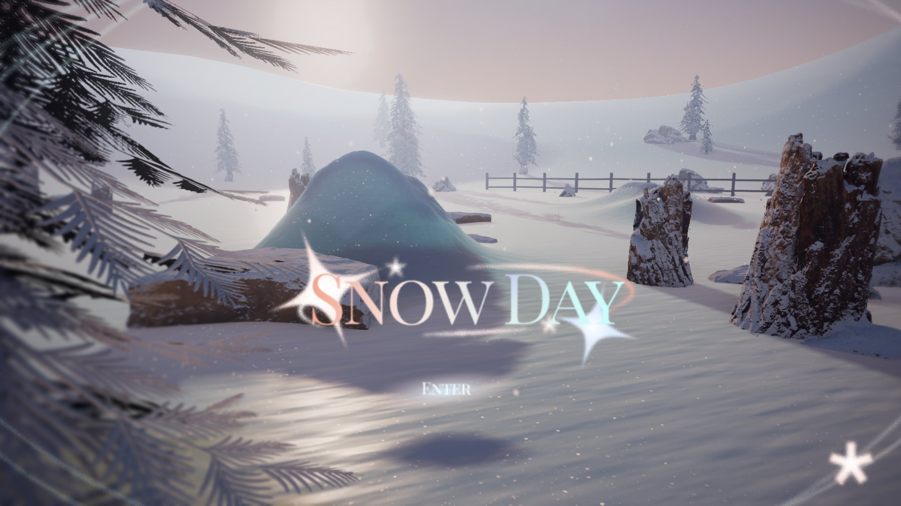
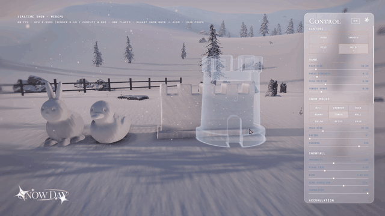

# Snow Day

**A quiet place to play in the snow, simulated live on your GPU.**

[**▶ Play it at snowday.crechetank.com**](https://snowday.crechetank.com) · Desktop browser with WebGPU required

[](https://snowday.crechetank.com)

Snow Day is a real-time snow sandbox built with Three.js, WebGPU and TSL. You walk through a winter valley about 400 m across, push snow around with your hand, and press snowmen and castle walls out of molds.

The snow runs in compute shaders every frame: it falls, settles, slumps down slopes, hardens in the wind and keeps your tracks. There's no build step, and three.js is the only dependency.

## What you can do



- **Shape the snow by hand.** Drag to scrape snow into a bank in front of your palm, or click to leave a handprint. Switch gestures to smooth it flat or pile it up. Move fast and powder sprays into the air.
- **Build with molds.** Nine shapes: ball, snowman, duck, bunny, tower, wall, igloo, spire and star. Click to press one, drag to lay a row, or stack them. Neighbors fuse together, and you can carve the result by hand.
- **Leave tracks.** Walk or sprint across the valley. Your marks stay in place as you move away and are still there when you come back, within 128 m.
- **Change the weather.** Sliders control time of day, cloud cover, haze, wind, snowfall, snow softness and crust, so you can go from a blue dawn to a low orange sunset in one drag.
- **Take a photo.** Press <kbd>P</kbd> to capture a clean frame without the UI, then save it as a PNG or share it.

The interface is available in English and Chinese, and a short in-world tour teaches the controls by having you try each one.

## How it works

| | |
|---|---|
| **Renderer** | `THREE.WebGPURenderer` with node materials written in TSL |
| **Snow simulation** | 3-level clipmap that follows the camera, 448² cells per level, 5.8 cm to 93 cm per cell, about 416 m simulated |
| **Interactive area** | 26 m window at 5.8 cm resolution, always around the player |
| **Track memory** | 2048² deformation map at 12.5 cm per cell, covering ±128 m |
| **Sculptures** | Signed distance field voxel grids, meshed with Surface Nets |
| **Particles** | Up to 90,000 snowflakes and 12,288 powder particles, simulated in compute |
| **Props** | About 1,950 instances in `BatchedMesh`, with 5 LODs and dithered crossfades |
| **Shadows** | 4 cascades out to 260 m, plus ray-marched self-shadowing on the snow |
| **Post-processing** | GTAO, TRAA, god rays, bloom, lens vignette and corner softening |
| **Codebase** | About 8,000 lines of JavaScript across 20 modules |

### A snowfield that scales

Covering 400 m at the 5.8 cm needed for handprints would take about 51 million cells. Instead, three windows of the same size slide with the camera, each with cells four times larger than the last.

Each window wraps around its buffer, so moving the camera only refills the newly exposed cells. All three levels share one equilibrium depth function that depends only on world position, so they meet at the same height along their seams. That function also clears snow off steep slopes and scours windward faces.

### Snow that behaves like snow

Each cell tracks depth, compaction and wind crust. Snow slumps toward an angle of repose through antisymmetric flows that conserve mass. Fresh powder is bright and full of glints, wind crust is denser and smoother, and snow you've pressed is the darkest and bluest of the three. Touching a crust breaks it.

Packing also changes the physics. Packed snow can stand much steeper than the loose powder around it, which is why a mold's base pad holds its shape.

### Blue that comes from physics

Snow is shaded as a dense scattering medium. The material estimates how far light travels through it and applies Beer–Lambert absorption using ice coefficients. Ice absorbs red light 20 times more strongly than blue, so handprints and hollows turn blue without any hand-picked tint.

The surface sparkle comes from ice crystals rendered as individual points across three scales. They are brightest on fresh snow and disappear where it's been compacted or crusted over.

### Sculptures with real overhangs

A heightfield stores one height per point, so it can't represent a snowman's neck or an igloo doorway. Molds are 3D signed distance fields instead, meshed on the CPU with Surface Nets at up to 5 ms per frame.

Merging happens in distance-field space, so shapes fuse with a soft fillet. Sculptures use the same snow shading as the ground and sample its compaction and lighting at their base, which hides the join.

### Atmosphere without a lookup table

Aerial perspective is solved in closed form at about 30 ALU instructions, rather than baked into the usual 3D LUT. The camera stays near the ground, so the integral through an exponential haze layer has an exact solution. Valleys fill with haze and ridges stay clear, which gives the scene its sense of distance.

### Built to run on the web

The first page load is about 23 MB, plus three.js from the CDN. A Python script resizes each model texture by its role, which took the source models from about 540 MB to 17 MB. The largest rock went from 210 MB to 4.5 MB with its geometry untouched.

The compute work measures 0.60–0.70 ms on an RTX 5090, and that machine holds 60 FPS at 1600×900. The landing page doubles as a benchmark: if the live scene runs below 30 FPS, Snow Day drops to low quality and tests again before asking whether you want to continue.

### Bugs worth reading about

The full writeup keeps the debugging history, because several of these bugs changed the design:

- **Far-field moiré:** a 2D FFT of a screenshot measured a 1 m period, which matched the terrain heightmap rather than the 0.93 m simulation grid. The cause was smoothstep weights in the terrain interpolator.
- **Silently broken god rays:** adding cascaded shadows left the effect reading a shadow map that no longer existed. Toggling it changed only 2.3% of pixels until the fix brought that to 94%.
- **Peter-panning:** depth bias scaled with the shadow camera's range, which pushed shadows meters away from their objects.

Read the full writeup in **[TECHNICAL.md](TECHNICAL.md)**.

## Run it locally

You need any static file server, because ES modules and WebGPU don't run from `file://`.

```bash
git clone https://github.com/miazhang2025/snowday.git
cd snowday
npm run dev
```

Then open <http://localhost:8123>. `python -m http.server 8123` works too.

**Requirements:** a desktop or laptop with a mouse or trackpad, and a browser with WebGPU, such as Chrome or Edge 113+. Phones and tablets are blocked by design, because the camera controls need a right mouse button and scroll wheel. You also need an internet connection, since three.js and the fonts come from CDNs.

## Controls

| Input | Action |
|---|---|
| **Left drag** | Push snow, or lay a row of molds |
| **Left click** | Leave a handprint, or press a mold |
| **Right drag / middle drag / wheel** | Orbit / pan / zoom |
| <kbd>W</kbd> <kbd>A</kbd> <kbd>S</kbd> <kbd>D</kbd> | Walk |
| <kbd>Shift</kbd> | Sprint |
| <kbd>Q</kbd> / <kbd>E</kbd> | Move down / up |
| <kbd>1</kbd> <kbd>2</kbd> <kbd>3</kbd> <kbd>4</kbd> | Push / smooth / pile / mold |
| <kbd>M</kbd> | Next mold |
| <kbd>,</kbd> / <kbd>.</kbd> | Rotate mold |
| <kbd>[</kbd> / <kbd>]</kbd> | Change hand or mold size |
| <kbd>C</kbd> / <kbd>F</kbd> | Clear / fill snow |
| <kbd>Space</kbd> | Toggle snowfall |
| <kbd>P</kbd> | Take a photo |
| <kbd>H</kbd> | Toggle the control panel |
| <kbd>R</kbd> | Reset the view |

## Project layout

```
index.html          Import map, all DOM and all CSS
src/snowfield.js    Clipmap, compute passes, deformation map, snow material
src/sculpt.js       Voxel sculptures, Surface Nets mesher, merging, brushes
src/molds.js        The nine mold shapes as signed distance fields
src/interaction.js  Mouse to hand: ray marching, gestures, stamping
src/snowfall.js     Falling flakes and hand-thrown powder
src/terrain.js      Procedural heightmap shared by the CPU and GPU
src/batch.js        Prop batching, LOD generation and crossfades
src/sky.js          Sky, aerial perspective, image-based lighting, shadows
src/postfx.js       Render pipeline and post-processing
tools/              Python scripts that shrink models, textures and the HDRI
```

The rest of `src/` covers the app shell: boot, UI, landing page, tour, photo mode and translations.

## Tinker with it

The running scene is exposed on `window.__snow`, so you can experiment from the browser console:

```js
__snow.params.timeOfDay = 0.2;     // dawn
__snow.refresh();
__snow.applySettings();

__snow.U.debugMode.value = 1;      // sun visibility view

await __snow.loadModel('assets/cabin.glb', {   // your own model
  position: [3, 0, -2],
  center: true,
  snow: true,                      // coat up-facing surfaces in snow
});
```

## Credits

Built by [Mia Zhang](https://github.com/miazhang2025) with [three.js](https://threejs.org). The rock, stump, grass and soil assets are from Quixel, and the `winter_lake_01` HDRI is from [Poly Haven](https://polyhaven.com). The fonts are Cormorant SC and DM Mono.
